  
  
  
  

### `~/research`

| | |
|---|---|
| **Slaya: Order-Robust Decisions in High-Cardinality Classifiers** Preprint · [doi:10.5281/zenodo.22906245](https://doi.org/10.5281/zenodo.22906245) · [code](https://github.com/anshull-saxena/candidate-order-instability) | Decision-flip rate **47.3% → 16.1%** on Banking77 (K=77); ECE **0.246 → 0.096** |
| **SIFA: Reliable Neural Forecasting under Temporal Distribution Shift** Under review, IEEE Intelligent Systems · [code](https://github.com/anshull-saxena/BITS-PHD) | **33.6%** lower MAE on NIFTY 50; conformal coverage **0.35 → 0.93** |

### `~/projects`

| | | |
|---|---|---|
| [**EnaOS**](https://github.com/anshull-saxena/EnaOS) · [site](https://enaos.tech/) | AI-native Linux desktop shell; async multi-agent orchestration on local LLMs | `rust` `gtk4` `wayland` `ollama` |
| [**SheepDog ML**](https://github.com/anshull-saxena/SheepDog_ML) | Adversarially robust fake-news detection (RoBERTa), 92.8% accuracy under attack | `pytorch` `transformers` |
| [**EN–FR–HI NMT**](https://github.com/anshull-saxena/en-fr-hi) | MarianMT fine-tuned with back-translation, 30.5 BLEU EN→FR | `pytorch` `hugging-face` |
| [**OpenLib**](https://github.com/dstark5/Openlib/pull/126) | Merged PR #126: social book sharing with thumbnail rendering | `flutter` `dart` |

### `~/stack`

### `~/activity`

<picture>
  <source media="(prefers-color-scheme: dark)" srcset="assets/snake-dark.svg" />
  
</picture>

